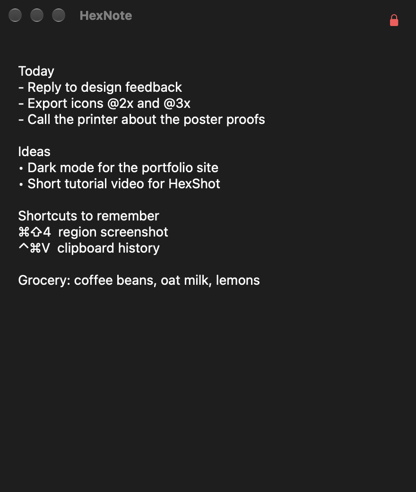

# HexNote

A lightweight single-page **sticky note** that lives on your macOS desktop. Everything you type is saved automatically and survives restarts.



## Features
- Auto-save (also saves before sleep and shutdown)
- Window layer: locked behind on the desktop, always on top, or normal
- Font size up/down (`⌘+` / `⌘-`), find (`⌘F`), copy the whole note
- Menu bar icon, launch at login, single-instance

## Privacy & security
- Makes no network connections.
- The note is stored only on this Mac in `~/Library/Application Support/HexNote` (readable only by your user account).

## Download
**[⬇ Download HexNote.dmg](https://github.com/Huseyinkayaw/HexNote/raw/main/release/HexNote.dmg)** — open it and drag **HexNote** into **Applications**.

Requires macOS 13+ on Apple Silicon (M1 or later). The app is not notarized by Apple, so macOS blocks the first launch ("Apple could not verify…"). Click **Done**, then go to **System Settings → Privacy & Security**, scroll down and click **Open Anyway** next to HexNote. Or run this once in Terminal:

```bash
xattr -dr com.apple.quarantine /Applications/HexNote.app
```

SHA-256: `38484ab71049c442a8e674b75c3e7c200e08f41f0c19c2e142c3220bc039b099`

## Build from source
Requirements: macOS 13+, Xcode Command Line Tools.

```bash
./build.sh     # builds HexNote.app
./make-dmg.sh  # runs tests, builds and creates HexNote.dmg
```

---

## Türkçe

Masaüstünde duran tek sayfalık, hafif bir **yapışkan not** uygulaması. Yazdığınız her şey otomatik kaydedilir ve yeniden başlatmada korunur.

**Özellikler**
- Otomatik kayıt (uyku / kapanma öncesi de kaydeder)
- Pencere katmanı: masaüstünde arkada kilitli, her zaman üstte veya normal
- Yazı boyutu büyütme/küçültme (`⌘+` / `⌘-`), bulma (`⌘F`), tüm notu kopyalama
- Menü çubuğu simgesi, girişte başlatma, tek kopya çalışma

**Gizlilik ve güvenlik**
- İnternete bağlanmaz.
- Not yalnızca bu Mac'te, `~/Library/Application Support/HexNote` içinde durur (yalnızca sizin kullanıcınız okuyabilir).

**İndir:** **[⬇ HexNote.dmg](https://github.com/Huseyinkayaw/HexNote/raw/main/release/HexNote.dmg)** — açın ve **HexNote**'i **Uygulamalar** klasörüne sürükleyin. macOS 13+ ve Apple Silicon (M1 veya üstü) gerekir. Uygulama Apple tarafından onaylanmadığı (notarize edilmediği) için macOS ilk açılışı engeller ("Apple … doğrulayamadı"). **Bitti**'ye basın, sonra **Sistem Ayarları → Gizlilik ve Güvenlik**'te aşağı inip HexNote için **Yine de Aç**'a tıklayın. Ya da Terminal'de bir kez şunu çalıştırın: `xattr -dr com.apple.quarantine /Applications/HexNote.app` SHA-256: `38484ab71049c442a8e674b75c3e7c200e08f41f0c19c2e142c3220bc039b099`

**Kaynaktan derleme:** macOS 13+ ve Xcode Command Line Tools gerekir. `./build.sh` HexNote.app'i derler; `./make-dmg.sh` testleri çalıştırır, derler ve `HexNote.dmg` üretir.
